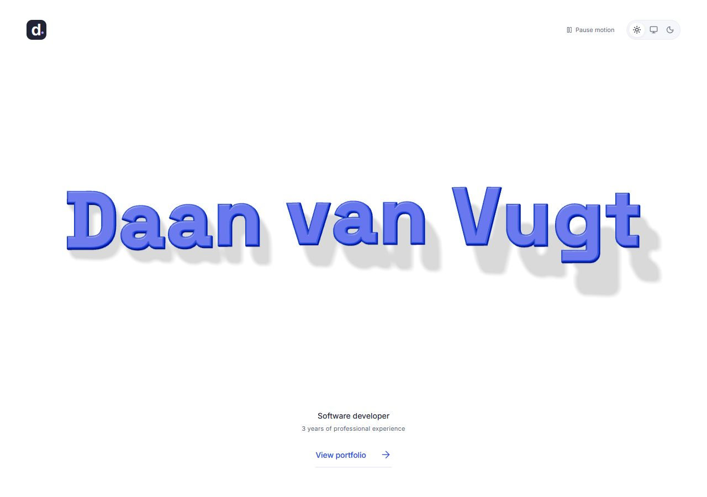

# Daan van Vugt — Portfolio

A personal portfolio built with React, TypeScript, Vite, and Three.js. The landing page uses interactive 3D typography, followed by a bento-style overview of professional and personal projects.



Features include individual letter interactions, light/dark themes, motion controls, and a local workshop for comparing fonts and movement.

The current design uses a single-row sculpted-name landing page, leading into the existing responsive bento overview. The selected combination is Space Grotesk Bold, Bouncy movement, and slow idle movement. Both layouts share theme and motion controls. Case-study routes retain factual draft content; detailed stories remain deferred.

## Run locally

Requires a current Node.js version supported by Vite (this build was verified with the installed Node runtime).

```sh
npm ci
npm run dev -- --port 5173
```

Open http://127.0.0.1:5173. On Windows, `npm.cmd` works if PowerShell execution policy prevents `npm.ps1` from running. `start-preview.cmd` starts the same local server from this directory. Stop it with Ctrl+C.

```sh
npm run check
npm run build
npm run preview
```

This is a client-side React/Vite site. For eventual hosting, serve `dist/` and configure an HTML fallback to `index.html` for project URLs. Hosting is deliberately deferred.

## Customise

- `src/data/portfolio.ts`: your headline, background, technologies, project copy, project links, email, and LinkedIn. Missing email/LinkedIn destinations intentionally render as labelled text, not broken links.
- `src/styles.css`: light/dark colour variables, spacing, card radius, desktop grid spans, responsive layouts, and animation timing.
- `src/App.tsx`: overview tile compositions, project templates, layout routing, and legacy anchor redirects. `src/main.tsx` contains only the app startup.
- `src/data/landing.ts`: landing copy, font source, blue material colours, depth, bevels, tracking, lighting/shadow palette, spring strength, and movement bounds.
- `src/graphics/nameScene.ts`: the lazily loaded Three.js scene, individual letter geometry, lighting, pointer/touch response, on-demand rendering, and disposal.
- `src/components/LandingPage.tsx`, `LandingName.tsx`, and `src/landing.css`: the one-screen landing layout, semantic heading/fallback, and responsive styling.
- `src/state/Preferences.tsx`: shared light/dark/system and motion preferences. Theme persists across reloads; manual motion pause persists during route navigation. Device reduced-motion preferences take precedence.
- `src/components/ui/`: local, editable shadcn-style card/button primitives. Button uses Radix Slot and class-variance-authority.

Routes: `/` (landing), `/portfolio` (bento overview), `/projects/vex`, `/projects/divergence`, and `/workshop` (local font/motion comparison). Existing `/#work`, `/#about`, and `/#contact` links redirect to their `/portfolio` equivalents. Unknown paths show a recovery page.

## Landing behaviour

The HTML name and portfolio link render immediately. The separate Three.js chunk loads the locally bundled font and replaces the visible fallback after the scene has painted. If the font or renderer fails, the fallback remains available. The canvas is decorative and hidden from accessibility tools; the semantic heading stays in the document.

Each letter has bounded horizontal/vertical travel, a pointer tilt, and a press/spring return. Mouse, pointer cancellation, and touch release return letters to their resting position. The selected slow idle motion runs while visible; turning idle off allows the renderer to stop when settled. Rendering stops when hidden or offscreen. Paused/reduced motion renders the settled composition; navigation stays available throughout.

The workshop compares Space Grotesk, Outfit, Bricolage Grotesque, and the original reference font, plus Original/Responsive/Bouncy motion. Its selections are encoded in the URL. The selected look is `/workshop?motion=bouncy&font=space&idle=1`; changing workshop controls does not rewrite the landing-page defaults. Motion presets are in `src/data/workshop.ts`.

Three.js adds a lazily loaded graphics chunk of about 147 kB gzip. Vite reports its standard 500 kB uncompressed chunk advisory; the build succeeds. The overview does not create a WebGL scene.

## Current content boundaries

VEX: app development alongside a colleague at Valk Digital, across features, backend integrations, testing, deployment, and maintenance. Confirmed technologies: React Native, TypeScript, Expo, Redux Toolkit. The app/service/database drawing is conceptual, not a claim about production architecture. Product capabilities are sourced from the official store listings; no product metric is attributed to Daan.

Divergence: a personal standalone fork built on the work of pret, RHH, and Pokabbie. Project-level build/test descriptions come from the repository documentation. The next review should choose one specific engineering story and confirm Daan’s contribution before expanding the case study.

Public email, LinkedIn, detailed contribution stories, and any résumé download are not yet supplied. No inferred personal contact information is used.

## Imagery and reference

- Visual reference: https://shadcnstudio.com/blocks/bento-grid/bento-grid (Grid 14). The layout and illustrations here are custom source, rather than copied premium block code.
- VEX screenshots: official Google Play listing, https://play.google.com/store/apps/details?id=nl.valkexclusief. The stored images are the original store graphics, displayed within CSS phone frames. Credits remain with Valk Digital / Valk Exclusief.
- iOS listing: https://apps.apple.com/nl/app/van-der-valk-exclusief/id435109159.
- Divergence map render: copied from the existing local project’s `build/portal_room/room-native.png`, a real development render, not a claimed in-game capture. Repository: https://github.com/DaanvanVugt99/pokeemerald-rogue.
- Inter is bundled locally through Fontsource; its OFL license is included with the dependency.
- Helvetiker Bold comes from Three.js’s example font distribution. The original metadata is retained in `public/fonts/helvetiker_bold.typeface.json`, and the font permission notice is included in `public/fonts/HELVETIKER-LICENSE.txt`.
- Space Grotesk, Outfit, and Bricolage Grotesque come from Google Fonts’ official repository. Derived local 700-weight typeface JSON and fallback WOFF2 files are accompanied by their original OFL notices. Original source URLs and license notices are retained in the typeface metadata.

## Review checklist

Start with the landing’s letterforms, material, scale, shadows, and tactile response. The existing overview now uses factual headings and descriptions. [DESIGN_NOTES.md](DESIGN_NOTES.md) records the agreed principles and reference observations. Then select the technical stories for each project.

Accessibility provisions include keyboard-visible focus, a skip link, route focus handling, reduced-motion CSS, an explicit motion pause control, and automatic offscreen animation pausing. The theme follows the system until explicitly chosen and then persists between reloads.
